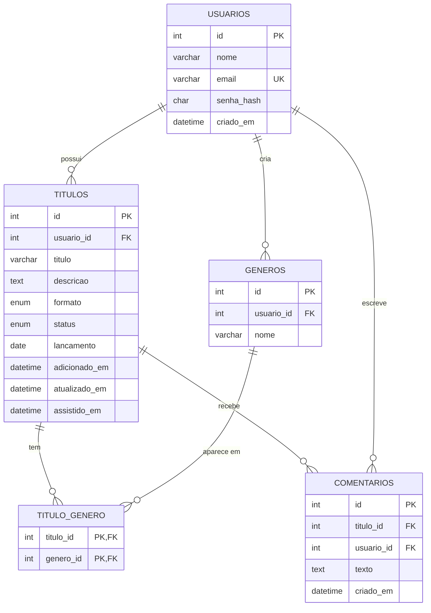

# Banco de dados — CineAnchieta

Banco do projeto do grupo, criado na Aula 2 e usado pela API a partir da Aula 3: **`cineanchieta`**. A partir da Aula 4, a API também grava, atualiza e remove títulos. Na Aula 5, o dono de cada título passa a ser quem fez login, e a senha fica guardada só como hash bcrypt. Na Aula 6, os gêneros saem de `titulo_genero` e voltam em cada título com `GROUP_CONCAT`; o painel passa a ser contado no banco com `GROUP BY`.

O script principal é o [`script.sql`](script.sql). Ele **recria o banco do zero** (tem um `DROP DATABASE`), então rode-o apenas quando quiser resetar os dados.

## DER



> O Workbench não desenha o DER a partir do script. Este diagrama serve para conferir o modelo. No caderno, desenhe as quatro caixas base e as três ligações; para o desafio Ouro, acrescente a quinta caixa (`comentarios`).

**Imagem para a apresentação:** [`der-cineanchieta.png`](der-cineanchieta.png) — as 4 tabelas base do projeto, pronta para colar no slide ou no Word. O diagrama acima também mostra a tabela opcional `comentarios`, criada só por quem rodou o desafio Ouro da Aula 2.

## As quatro tabelas base

| Tabela | Guarda | Ligações |
| --- | --- | --- |
| `usuarios` | nome, e-mail (único) e o hash da senha — nunca a senha | — |
| `titulos` | título, descrição, formato, status, lançamento e datas | `usuario_id` → `usuarios` (1 usuário : N títulos) |
| `generos` | o nome de cada gênero, por usuário | `usuario_id` → `usuarios` |
| `titulo_genero` | qual gênero está em qual título | `titulo_id` → `titulos` e `genero_id` → `generos` (N:N) |

### Por que os gêneros precisaram de duas tabelas?

Porque um título tem vários gêneros, e um gênero aparece em vários títulos. Uma coluna só guarda um valor. A tabela `titulo_genero` resolve essa relação N:N: cada linha liga um título a um gênero.

## Da interface TypeScript para a tabela

| Na interface `Titulo` | Na tabela `titulos` | O que muda |
| --- | --- | --- |
| `readonly id: number` | `id INT UNSIGNED AUTO_INCREMENT` | o banco gera o id sozinho |
| `titulo: string` | `titulo VARCHAR(120) NOT NULL` | texto com tamanho máximo |
| `descricao?: string \| null` | `descricao TEXT NULL` | opcional vira `NULL` |
| `formato: Formato` | `ENUM('filme','serie')` | union type vira `ENUM` |
| `status: Status` | `ENUM('quero_ver','assistindo','assisti')` | idem |
| `generos: string[]` | tabelas `generos` e `titulo_genero` | uma coluna não guarda lista |
| `lancamento?: string \| null` | `lancamento DATE NULL` | a data do tema |
| `adicionadoEm: Date` | `adicionado_em DATETIME` | camelCase vira snake_case |
| (não existia) | `usuario_id` + chave estrangeira | todo título passa a ter dono |

## Como executar

1. Abra o MySQL Workbench e conecte com o usuário `root`.
2. Vá em **File → Open SQL Script** e escolha `banco/script.sql`.
3. Clique no botão do raio para executar tudo.
4. Na aba **Schemas**, clique em **Refresh**: o banco `cineanchieta` aparece com as quatro tabelas.

Se o Workbench reclamar de `utf8mb4_0900_ai_ci`, seu servidor é MariaDB (XAMPP), não MySQL 8. Troque a collation por `utf8mb4_unicode_ci` no `CREATE DATABASE`.

## Conferência

Rode uma consulta de cada vez:

```sql
USE cineanchieta;

-- 7 linhas: 6 da Ana e 1 do Bruno
SELECT * FROM titulos;

-- O painel da Ana, por status: 2 quero_ver, 2 assistindo, 2 assisti
SELECT status, COUNT(*) AS quantidade
FROM titulos
WHERE usuario_id = 1
GROUP BY status;

-- Repare: ninguém lê a senha; só o hash
SELECT email, senha_hash FROM usuarios;

-- Os gêneros de cada título (relação N:N)
SELECT t.titulo, g.nome AS genero
FROM titulos AS t
JOIN titulo_genero AS tg ON tg.titulo_id = t.id
JOIN generos AS g        ON g.id = tg.genero_id
ORDER BY t.id, g.nome;
```

Os usuários de exemplo são **Ana** e **Bruno**, ambos com a senha `senha123`. O banco guarda apenas o hash bcrypt.

## Conferência da Aula 4

Depois de usar os botões da página (ou as rotas da API), confira no Workbench:

```sql
USE cineanchieta;

-- A lista da Ana: 6 títulos; o #7 é do Bruno e a API não deve mexer nele
SELECT id, titulo, status, assistido_em
FROM titulos
WHERE usuario_id = 1
ORDER BY id;

-- Concluir preenche assistido_em; reabrir apaga a data
SELECT id, titulo, status, assistido_em
FROM titulos
WHERE id = 1;
```

O `UPDATE` e o `DELETE` da API filtram por `id` **e** `usuario_id`. Por isso, tentar mexer no título #7 (do Bruno) devolve **404**, mesmo ele existindo no banco.

## Conferência da Aula 5

O login não compara senha em SQL. A API busca o hash pelo e-mail, confere com `bcrypt.compare` e assina um JWT com o id do usuário. Nas rotas de títulos, o `usuario_id` vem desse token:

```sql
USE cineanchieta;

-- Duas contas; o hash bcrypt tem 60 caracteres e nunca é devolvido pela API
SELECT id, nome, email, CHAR_LENGTH(senha_hash) AS tamanho_hash
FROM usuarios;

-- Cada título pertence a quem o criou
SELECT u.nome AS dono, t.id, t.titulo, t.status
FROM titulos AS t
JOIN usuarios AS u ON u.id = t.usuario_id
ORDER BY t.id;
```

Para conferir o isolamento, tente apagar o título #3 com o token do Bruno:

```sql
-- O que a API executa no DELETE; com usuario_id = 2, afeta 0 linhas
DELETE FROM titulos WHERE id = 3 AND usuario_id = 2;

-- O título continua com a Ana
SELECT id, usuario_id, titulo FROM titulos WHERE id = 3;
```

Como nenhuma linha casa com `id = 3 AND usuario_id = 2`, o `DELETE` afeta **0 linhas** e a API responde **404** — igual a um título que não existe. O mesmo filtro aparece no `SELECT`, no `UPDATE` e no `PATCH`.

## Conferência da Aula 6

Os gêneros continuam guardados em `generos` e `titulo_genero`; a novidade é a leitura em uma linha só por título e o painel calculado no banco.

```sql
USE cineanchieta;

-- Os gêneros de cada título da Ana, em uma linha (GROUP_CONCAT)
SELECT t.id, t.titulo,
       (SELECT GROUP_CONCAT(g.nome ORDER BY g.nome SEPARATOR ',')
          FROM titulo_genero AS tg
          JOIN generos AS g ON g.id = tg.genero_id
         WHERE tg.titulo_id = t.id) AS generos
FROM titulos AS t
WHERE t.usuario_id = 1
ORDER BY t.titulo;

-- O painel da Ana: 2 quero_ver, 2 assistindo, 2 assisti
SELECT status, COUNT(*) AS quantidade
FROM titulos
WHERE usuario_id = 1
GROUP BY status;

-- A busca por gênero, como a API faz com EXISTS
SELECT DISTINCT t.id, t.titulo
FROM titulos AS t
WHERE t.usuario_id = 1
  AND EXISTS (
    SELECT 1
      FROM titulo_genero AS tg
      JOIN generos AS g ON g.id = tg.genero_id
     WHERE tg.titulo_id = t.id
       AND g.nome LIKE '%terror%'
  )
ORDER BY t.titulo;
```

Para conferir pela API, depois do login:

```js
const painel = await fetch("/api/estatisticas", {
  headers: { Authorization: `Bearer ${token}` },
}).then((r) => r.json());

console.log(painel); // { quero_ver: 2, assistindo: 2, assisti: 2 }
```

## Conferência realizada

Em 10/11/2026 o `script.sql` foi executado em **MySQL 8.4.13**:

- 4 tabelas criadas: `usuarios`, `titulos`, `generos` e `titulo_genero`.
- 7 títulos: 6 da Ana e 1 do Bruno.
- Painel da Ana: 2 `quero_ver`, 2 `assistindo` e 2 `assisti`.
- Os três testes de erro retornaram os códigos **1265**, **3819** e **1452**.
- Os desafios Prata e Ouro também rodaram sem erro.

## Testes de erro

O arquivo [`testes_erros.sql`](testes_erros.sql) provoca as três proteções do banco:

| Teste | Proteção | Erro esperado |
| --- | --- | --- |
| `status = 'feito'` | `ENUM` | `1265 — Data truncated for column 'status'` |
| Título `'ab'` | `CHECK` | `3819 — Check constraint 'ck_titulos_titulo' is violated` |
| `usuario_id = 99` | chave estrangeira | `1452 — a foreign key constraint fails` |

Rode **um comando por vez**, selecionando a linha e clicando no raio. Depois rode o `INSERT` válido do fim do arquivo e veja o id recebido: os números das tentativas que falharam podem ter sido pulados.

## Desafios da Entrega 2

- [`desafio_prata.sql`](desafio_prata.sql): dois títulos novos da Ana, cada um com um gênero ligado em `titulo_genero`.
- [`desafio_ouro.sql`](desafio_ouro.sql): tabela `comentarios` (um título tem muitos comentários) com exemplos.

Rode os dois **depois** do `script.sql`. O diagrama acima já inclui a tabela `comentarios` do desafio Ouro; os detalhes dela estão abaixo.

### Tabela `comentarios` (desafio Ouro)

| Coluna | Tipo | Regra |
| --- | --- | --- |
| `id` | `INT UNSIGNED` | chave primária, `AUTO_INCREMENT` |
| `titulo_id` | `INT UNSIGNED` | FK → `titulos.id`, `ON DELETE CASCADE` |
| `usuario_id` | `INT UNSIGNED` | FK → `usuarios.id`, `ON DELETE CASCADE` |
| `texto` | `TEXT` | `NOT NULL`, `CHECK` de texto não vazio |
| `criado_em` | `DATETIME` | padrão `CURRENT_TIMESTAMP` |

Relação: **1 título : N comentários**.
