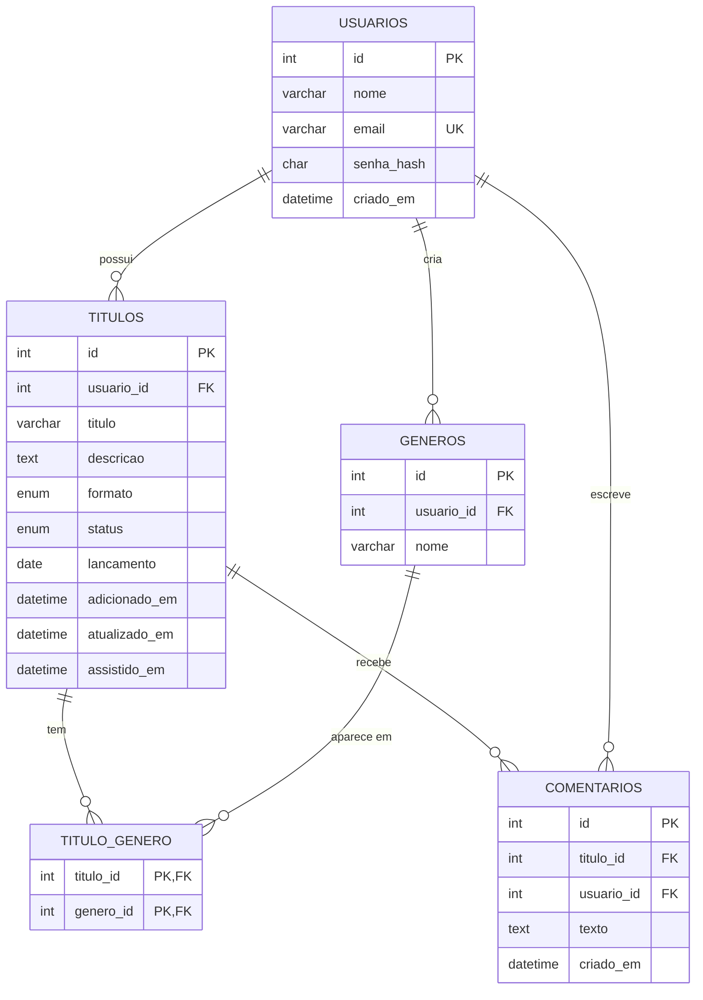

# Banco de dados — CineAnchieta

Banco do projeto do grupo para a Aula 2: **`cineanchieta`**.

O script principal é o [`script.sql`](script.sql). Ele **recria o banco do zero** (tem um `DROP DATABASE`), então rode-o apenas quando quiser resetar os dados.

## DER



> O Workbench não desenha o DER a partir do script. Este diagrama serve para conferir o modelo. No caderno, desenhe as quatro caixas base e as três ligações; para o desafio Ouro, acrescente a quinta caixa (`comentarios`).

## As quatro tabelas base

| Tabela | Guarda | Ligações |
| --- | --- | --- |
| `usuarios` | nome, e-mail (único) e o hash da senha — nunca a senha | — |
| `titulos` | título, descrição, formato, status, lançamento e datas | `usuario_id` → `usuarios` (1 usuário : N títulos) |
| `generos` | o nome de cada gênero, por usuário | `usuario_id` → `usuarios` |
| `titulo_genero` | qual gênero está em qual título | `titulo_id` → `titulos` e `genero_id` → `generos` (N:N) |

### Por que os gêneros precisaram de duas tabelas?

Porque um título tem vários gêneros, e um gênero aparece em vários títulos. Uma coluna só guarda um valor. A tabela `titulo_genero` resolve essa relação N:N: cada linha liga um título a um gênero.

## Da interface TypeScript para a tabela

| Na interface `Titulo` | Na tabela `titulos` | O que muda |
| --- | --- | --- |
| `readonly id: number` | `id INT UNSIGNED AUTO_INCREMENT` | o banco gera o id sozinho |
| `titulo: string` | `titulo VARCHAR(120) NOT NULL` | texto com tamanho máximo |
| `descricao?: string \| null` | `descricao TEXT NULL` | opcional vira `NULL` |
| `formato: Formato` | `ENUM('filme','serie')` | union type vira `ENUM` |
| `status: Status` | `ENUM('quero_ver','assistindo','assisti')` | idem |
| `generos: string[]` | tabelas `generos` e `titulo_genero` | uma coluna não guarda lista |
| `lancamento?: string \| null` | `lancamento DATE NULL` | a data do tema |
| `adicionadoEm: Date` | `adicionado_em DATETIME` | camelCase vira snake_case |
| (não existia) | `usuario_id` + chave estrangeira | todo título passa a ter dono |

## Como executar

1. Abra o MySQL Workbench e conecte com o usuário `root`.
2. Vá em **File → Open SQL Script** e escolha `banco/script.sql`.
3. Clique no botão do raio para executar tudo.
4. Na aba **Schemas**, clique em **Refresh**: o banco `cineanchieta` aparece com as quatro tabelas.

Se o Workbench reclamar de `utf8mb4_0900_ai_ci`, seu servidor é MariaDB (XAMPP), não MySQL 8. Troque a collation por `utf8mb4_unicode_ci` no `CREATE DATABASE`.

## Conferência

Rode uma consulta de cada vez:

```sql
USE cineanchieta;

-- 7 linhas: 6 da Ana e 1 do Bruno
SELECT * FROM titulos;

-- O painel da Ana, por status: 2 quero_ver, 2 assistindo, 2 assisti
SELECT status, COUNT(*) AS quantidade
FROM titulos
WHERE usuario_id = 1
GROUP BY status;

-- Repare: ninguém lê a senha; só o hash
SELECT email, senha_hash FROM usuarios;

-- Os gêneros de cada título (relação N:N)
SELECT t.titulo, g.nome AS genero
FROM titulos AS t
JOIN titulo_genero AS tg ON tg.titulo_id = t.id
JOIN generos AS g        ON g.id = tg.genero_id
ORDER BY t.id, g.nome;
```

Os usuários de exemplo são **Ana** e **Bruno**, ambos com a senha `senha123`. O banco guarda apenas o hash bcrypt.

## Testes de erro

O arquivo [`testes_erros.sql`](testes_erros.sql) provoca as três proteções do banco:

| Teste | Proteção | Erro esperado |
| --- | --- | --- |
| `status = 'feito'` | `ENUM` | `1265 — Data truncated for column 'status'` |
| Título `'ab'` | `CHECK` | `3819 — Check constraint 'ck_titulos_titulo' is violated` |
| `usuario_id = 99` | chave estrangeira | `1452 — a foreign key constraint fails` |

Rode **um comando por vez**, selecionando a linha e clicando no raio. Depois rode o `INSERT` válido do fim do arquivo e veja o id recebido: os números das tentativas que falharam podem ter sido pulados.

## Desafios da Entrega 2

- [`desafio_prata.sql`](desafio_prata.sql): duas tarefas novas da Ana, cada uma com uma tag ligada em `titulo_genero`.
- [`desafio_ouro.sql`](desafio_ouro.sql): tabela `comentarios` (uma tarefa tem muitos comentários) com exemplos.

Rode os dois **depois** do `script.sql`. O diagrama acima já inclui a tabela `comentarios` do desafio Ouro; os detalhes dela estão abaixo.

### Tabela `comentarios` (desafio Ouro)

| Coluna | Tipo | Regra |
| --- | --- | --- |
| `id` | `INT UNSIGNED` | chave primária, `AUTO_INCREMENT` |
| `titulo_id` | `INT UNSIGNED` | FK → `titulos.id`, `ON DELETE CASCADE` |
| `usuario_id` | `INT UNSIGNED` | FK → `usuarios.id`, `ON DELETE CASCADE` |
| `texto` | `TEXT` | `NOT NULL`, `CHECK` de texto não vazio |
| `criado_em` | `DATETIME` | padrão `CURRENT_TIMESTAMP` |

Relação: **1 título : N comentários**.
